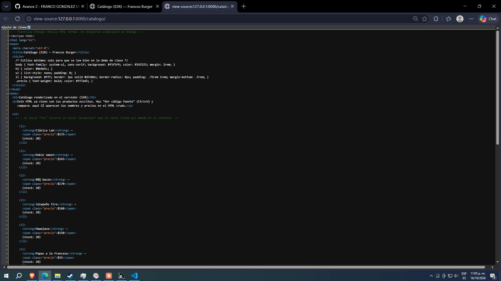
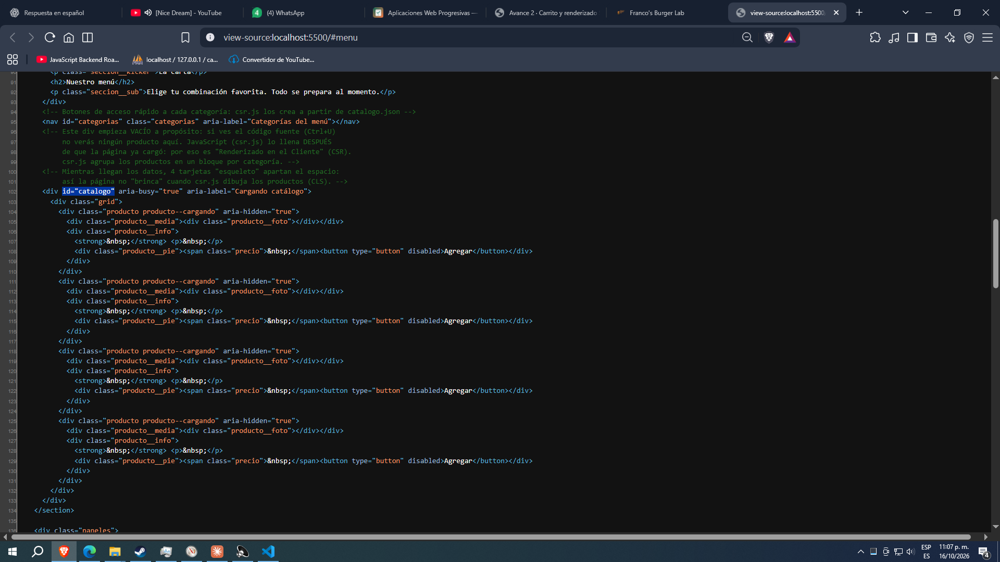
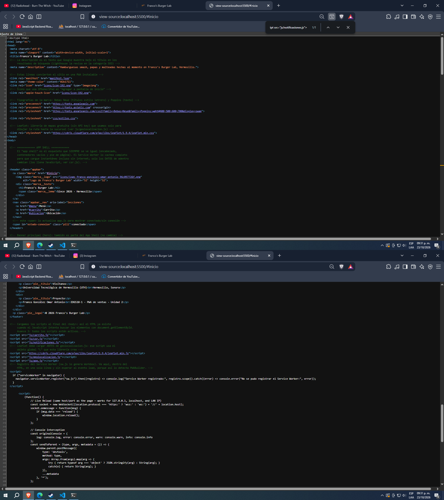
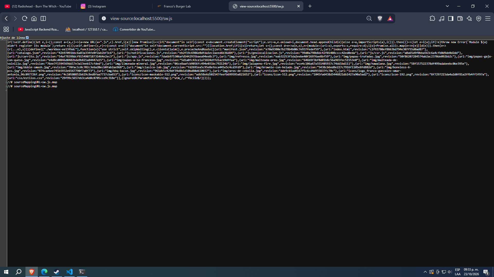
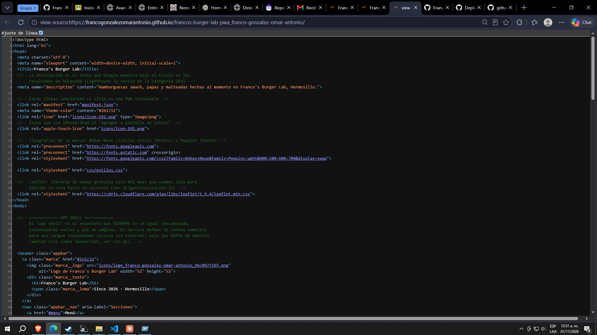
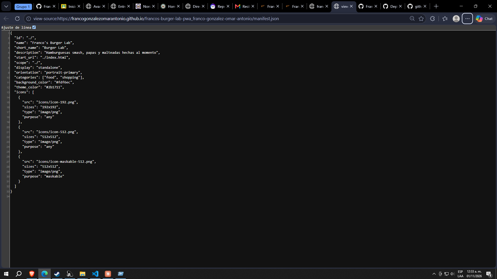
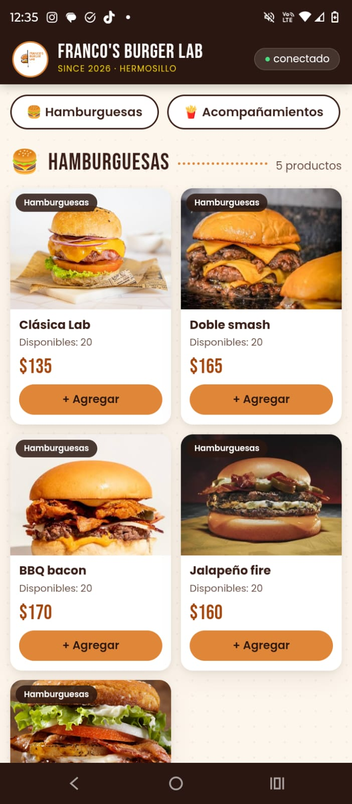

# Franco's Burger Lab — PWA de ventas

| Dato | Valor |
|---|---|
| **Alumno** | FRANCO GONZÁLEZ OMAR ANTONIO (apellido paterno: Franco · apellido materno: González · nombres: Omar Antonio) |
| **Grupo** | IDGS10-1 |
| **Negocio · giro** | Franco's Burger Lab · Hamburguesería |
| **URL del repositorio** | https://github.com/FrancoGonzalezOmarAntonio/francos-burger-lab-pwa_franco-gonzalez-omar-antonio |
| **URL de GitHub Pages** | https://francogonzalezomarantonio.github.io/francos-burger-lab-pwa_franco-gonzalez-omar-antonio/ |

## Descripción

Aplicación Web Progresiva (PWA) de ventas para **Franco's Burger Lab**, hamburguesería en Hermosillo, Sonora.
El catálogo de 15 productos (hamburguesas, acompañamientos, bebidas y postres) se carga desde `catalogo.json`
y se dibuja en el navegador con JavaScript (Renderizado en el Cliente, CSR), agrupado en sus 3 categorías.
El carrito (agregar, sumar/restar, quitar y total) se guarda en `localStorage`, así que sigue ahí al recargar.

Para comparar, `servidor-FAGO/` es un proyecto Django que muestra los mismos productos
renderizados en el servidor (SSR).

## Estructura del repositorio

```
index.html        App Shell (encabezado, catálogo, carrito, pie de página)
catalogo.json     15 productos: id, nombre, categoria, precio, stock, imagen
css/estilos.css   Paleta de marca y diseño responsivo
js/csr.js         fetch() de catalogo.json, agrupado por categoría y pintado de tarjetas
js/carrito.js     Carrito con localStorage: agregar, sumar/restar, quitar y total
js/notificaciones.js  Permiso de notificaciones y aviso "Pedido agregado"
js/geolocalizacion.js Ubicación del cliente y ruta (Leaflet + OSRM) a la sucursal UTH
js/app.js         Píldora de estado conectado / sin conexión
manifest.json     Nombre, colores de marca e íconos 192/512 de la PWA
workbox-config.js Configuración de Workbox (qué archivos se precachean)
sw.js             Service Worker generado por Workbox (+ workbox-XXXX.js y .map)
icons/            Logo e íconos de la PWA
img/              15 fotografías de los productos
docs/             Capturas, reportes de Lighthouse (móvil/escritorio) y reporte de pruebas en PDF
servidor-FAGO/    Proyecto Django (SSR): app "catalogo" con los 15 productos
```

## Probar en local

**PWA (CSR):** abre la carpeta en VS Code y usa **Live Server** sobre `index.html`
(`fetch()` no funciona abriendo el archivo con doble clic, necesita un servidor).

**Django (SSR):**

```
cd servidor-FAGO
python -m venv venv
venv\Scripts\activate
pip install django
python manage.py runserver
```

Luego abre http://127.0.0.1:8000/catalogo/

## Historial de avances

| Avance | Hash del commit entregado | Fecha |
|---|---|---|
| 1 | 2194f94 | 11/10/2026 |
| 2 | 7921438 | 18/10/2026 |
| 3 | 977415f | 25/10/2026 |
| 4 | (se escribe en el reporte PDF) | 01/11/2026 |

> El README no puede contener el hash de su propio commit (al guardarlo cambia el hash):
> aquí se anotan los hashes de los avances anteriores.

## Comparación SSR vs CSR

### SSR (Django): los productos llegan escritos en el HTML


### CSR (JavaScript): el div del catálogo llega vacío


## PWA: manifest y Service Worker

### index.html con manifest, notificaciones, geolocalización y registro del Service Worker


### sw.js generado por Workbox (precache con catalogo.json y las fotos .jpg)


## Auditoría con Lighthouse (avance 4)

Reportes generados desde la terminal contra la versión publicada en GitHub Pages:

```
npx lighthouse https://francogonzalezomarantonio.github.io/francos-burger-lab-pwa_franco-gonzalez-omar-antonio/ --output=html --output-path=./docs/lighthouse-movil.html
npx lighthouse https://francogonzalezomarantonio.github.io/francos-burger-lab-pwa_franco-gonzalez-omar-antonio/ --preset=desktop --output=html --output-path=./docs/lighthouse-escritorio.html
```

| Reporte | Performance | Accesibilidad | Buenas prácticas | SEO |
|---|---|---|---|---|
| [Móvil](docs/lighthouse-movil.html) | 93 | 100 | 100 | 100 |
| [Escritorio](docs/lighthouse-escritorio.html) | 98 | 100 | 100 | 100 |

## Versión publicada (avance 4)

### index.html en GitHub Pages


### manifest.json en GitHub Pages


### Mi app instalada en el celular


## Guía de instalación

Franco's Burger Lab no necesita tienda de aplicaciones: se instala directo desde el navegador.

### 1. Abrir la app

1. En tu celular o computadora entra a
   **https://francogonzalezomarantonio.github.io/francos-burger-lab-pwa_franco-gonzalez-omar-antonio/**
2. Espera a que cargue el menú con las fotos. En esa primera visita el Service Worker
   guarda la app en el dispositivo para que después funcione sin internet.

### 2. Instalarla

- **Android (Chrome):** toca el menú **⋮** (arriba a la derecha) → **Instalar app**
  (o **Agregar a la pantalla principal**) → **Instalar**.
- **iPhone (Safari):** toca el botón **Compartir** (cuadro con flecha) → **Agregar a inicio** → **Agregar**.
- **Computadora (Chrome o Edge):** haz clic en el ícono de instalar que aparece a la derecha
  de la barra de direcciones → **Instalar**.

Aparecerá el ícono de **Burger Lab** en tu pantalla de inicio (o en el menú de inicio de Windows).

### 3. Usarla

1. Abre la app desde su ícono: se muestra en pantalla completa, sin la barra del navegador.
2. **Menú:** usa los botones de categoría para ir a hamburguesas, acompañamientos o bebidas y postres,
   y toca **Agregar** en los productos que quieras.
3. **Tu pedido:** en el carrito sube o baja la cantidad con **+ / −** o quita un producto;
   el total se recalcula solo. El carrito se guarda aunque cierres la app.
4. **Sin internet:** el menú y las fotos siguen funcionando; la píldora de arriba cambia a
   *sin conexión*. Lo que agregues se sincroniza cuando vuelve la conexión (o con **Sincronizar carrito**).
5. **Promociones:** toca **Activar notificaciones** y acepta el permiso para recibir avisos de tus pedidos.
6. **Ubicación:** toca **Usar mi ubicación** y acepta el permiso para ver en el mapa la ruta,
   la distancia y el tiempo estimado hasta la sucursal de la UTH.

### Desinstalar

- **Android:** mantén presionado el ícono → **Desinstalar**.
- **iPhone:** mantén presionado el ícono → **Eliminar app**.
- **Computadora:** abre la app → menú **⋯** → **Desinstalar**.
