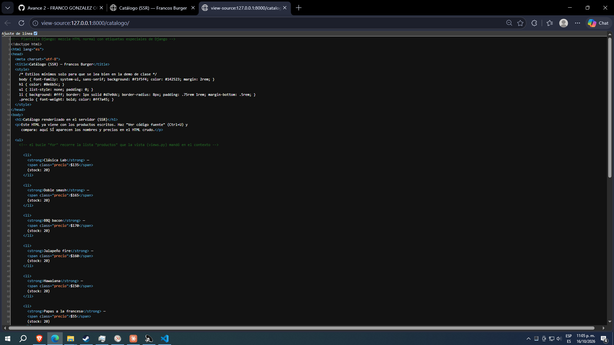
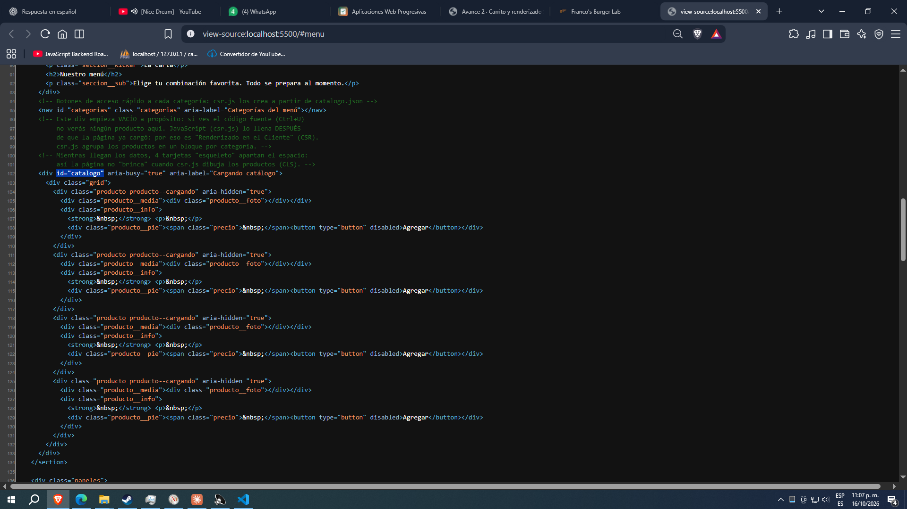

# Franco's Burger Lab — PWA de ventas

| Dato | Valor |
|---|---|
| **Alumno** | FRANCO GONZÁLEZ OMAR ANTONIO (apellido paterno: Franco · apellido materno: González · nombres: Omar Antonio) |
| **Grupo** | IDGS10-1 |
| **Negocio · giro** | Franco's Burger Lab · Hamburguesería |
| **URL del repositorio** | https://github.com/FrancoGonzalezOmarAntonio/francos-burger-lab-pwa_franco-gonzalez-omar-antonio |
| **URL de GitHub Pages** | https://francogonzalezomarantonio.github.io/francos-burger-lab-pwa_franco-gonzalez-omar-antonio/ |

## Descripción

Aplicación Web Progresiva (PWA) de ventas para **Franco's Burger Lab**, hamburguesería en Hermosillo, Sonora.
El catálogo de 15 productos (hamburguesas, acompañamientos, bebidas y postres) se carga desde `catalogo.json`
y se dibuja en el navegador con JavaScript (Renderizado en el Cliente, CSR), agrupado en sus 3 categorías.
El carrito (agregar, sumar/restar, quitar y total) se guarda en `localStorage`, así que sigue ahí al recargar.

Para comparar, `servidor-FAGO/` es un proyecto Django que muestra los mismos productos
renderizados en el servidor (SSR).

## Estructura del repositorio

```
index.html        App Shell (encabezado, catálogo, carrito, pie de página)
catalogo.json     15 productos: id, nombre, categoria, precio, stock, imagen
css/estilos.css   Paleta de marca y diseño responsivo
js/csr.js         fetch() de catalogo.json, agrupado por categoría y pintado de tarjetas
js/carrito.js     Carrito con localStorage: agregar, sumar/restar, quitar y total
js/               notificaciones, geolocalización, app (se activan por avance)
icons/            Logo e íconos de la PWA
img/              15 fotografías de los productos
docs/             Capturas de "Ver código fuente" (SSR vs CSR)
servidor-FAGO/    Proyecto Django (SSR): app "catalogo" con los 15 productos
```

## Probar en local

**PWA (CSR):** abre la carpeta en VS Code y usa **Live Server** sobre `index.html`
(`fetch()` no funciona abriendo el archivo con doble clic, necesita un servidor).

**Django (SSR):**

```
cd servidor-FAGO
python -m venv venv
venv\Scripts\activate
pip install django
python manage.py runserver
```

Luego abre http://127.0.0.1:8000/catalogo/

## Historial de avances

| Avance | Hash del commit entregado | Fecha |
|---|---|---|
| 1 | 2194f94 | 11/10/2026 |
| 2 | 7921438 | 18/10/2026 |
| 3 | | 25/10/2026 |
| 4 | (se escribe en el reporte PDF) | 01/11/2026 |

> El README no puede contener el hash de su propio commit (al guardarlo cambia el hash):
> aquí se anotan los hashes de los avances anteriores.

## Comparación SSR vs CSR

### SSR (Django): los productos llegan escritos en el HTML


### CSR (JavaScript): el div del catálogo llega vacío

